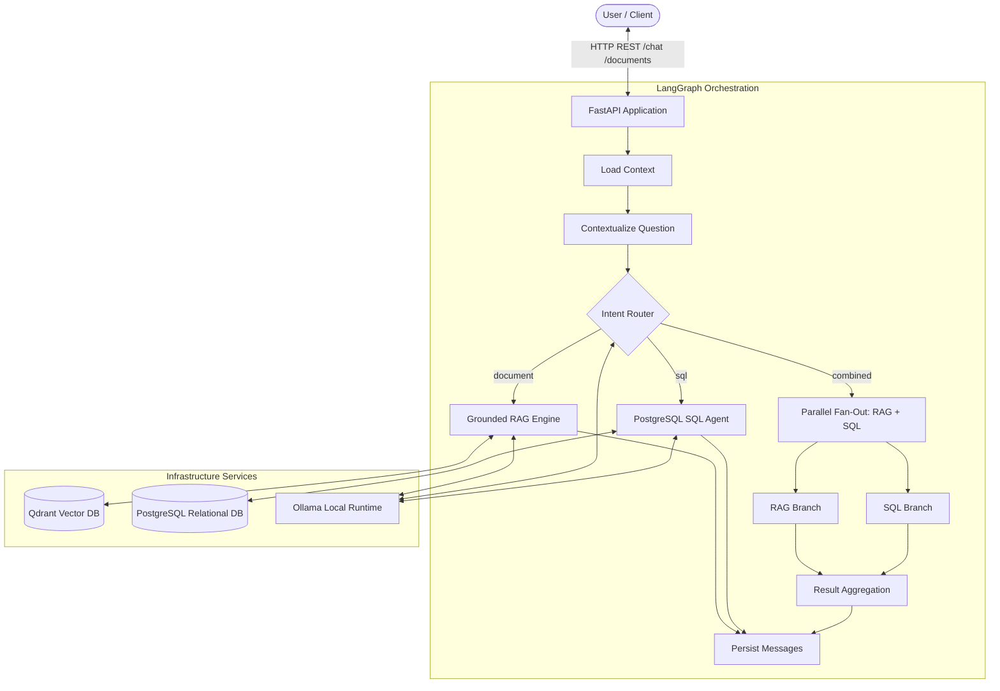

# Local GenAI Data Assistant

A production-grade, local-first conversational data assistant built with **Python 3.12**, **FastAPI**, **LangChain**, **LangGraph**, **Ollama**, **Qdrant**, and **PostgreSQL**.

The assistant provides an intelligent natural language interface across:
1. **Unstructured Documents**: Grounded Question-Answering across PDF, DOCX, TXT, and Markdown files with strict anti-prompt injection defenses, evidence thresholding, and source citation.
2. **Structured Relational Data**: Natural-Language-to-SQL (NL2SQL) querying PostgreSQL business tables (`customers`, `products`, `orders`, `order_items`, `refunds`) enforced by SQLGlot AST parsing, table whitelisting, and a restricted read-only database role.
3. **Combined Multi-Source Queries**: Multi-branch LangGraph orchestration running parallel document retrieval and database queries, synthesizing coherent answers with full source traceability.

Zero external cloud APIs or data leaks: 100% of data, prompts, embeddings, and inference remain local.

---

## Architecture Overview



For complete technical specifications, see [docs/architecture.md](docs/architecture.md).

---

## Technology Stack

| Layer | Technology | Purpose |
|---|---|---|
| **Language** | Python 3.12+ | Core runtime |
| **API Framework** | FastAPI + Uvicorn | High-performance asynchronous REST endpoints |
| **Validation & Settings** | Pydantic v2 + Pydantic Settings | Contract validation and environment configuration |
| **Local LLM Runtime** | Ollama | Local model inference (`qwen3:8b`, `qwen2.5:7b`, or `llama3.1:8b`) |
| **Local Embeddings** | Ollama (`nomic-embed-text`) | 768-dimensional local vector embeddings |
| **Vector Database** | Qdrant | Vector indexing, payload filtering, and deletion |
| **Relational Database** | PostgreSQL 16 | ACID business data, conversation & message persistence |
| **ORM & Migrations** | SQLAlchemy 2.0 (Async) + Alembic | Asynchronous database connection pool & migrations |
| **SQL Validation** | SQLGlot | AST parsing, recursive validation, and query limitation |
| **Document Parsing** | PyMuPDF + python-docx | Text & page extraction from PDF, DOCX, TXT, and Markdown |
| **Text Chunking** | LangChain Text Splitters | Recursive character splitting with page reference preservation |
| **Workflow Graph** | LangGraph | Stateful workflow routing, parallel execution, and retries |
| **Testing** | Pytest, Pytest-Asyncio, HTTPX | Unit, integration, security, and benchmark evaluation suites |
| **Code Hygiene** | Ruff | Ultra-fast linting and code formatting |

---

## Prerequisites

1. **Python 3.12+**
2. **Docker & Docker Compose** (for containerized execution)
3. **Ollama** installed locally (or via Docker Compose)

---

## Quickstart: Docker Compose (Single Command)

The entire application stack (API, PostgreSQL, Qdrant, Ollama) runs locally via Docker Compose.

### 1. Clone & Configure Environment
```bash
git clone https://github.com/local-genai/local-llm-rag.git
cd local-llm-rag

# Copy environment variables
cp .env.example .env
```

### 2. Start Services
```bash
docker compose up -d
```
Docker Compose initializes:
- `genai-postgres`: PostgreSQL 16 with health checks and restricted `genai_readonly` role.
- `genai-qdrant`: Qdrant vector database on ports `6333` and `6334`.
- `genai-ollama`: Local model runtime on port `11434`.
- `genai-api`: FastAPI application on port `8000`.

### 3. Initialize Models
On first startup, download the configured models into persistent Ollama storage:
```bash
./scripts/download_models.sh
```

### 4. Seed Business Database & Ingest Sample Documents
```bash
# Seed customers, products, orders, refunds
docker compose exec api python scripts/seed_database.py

# Ingest sample policy documents from data/documents/
docker compose exec api python scripts/ingest_documents.py
```

### 5. Access the API
- **Interactive OpenAPI Documentation**: [http://localhost:8000/docs](http://localhost:8000/docs)
- **Health Check**: [http://localhost:8000/api/v1/health](http://localhost:8000/api/v1/health)

---

## Local Development Setup (Without Docker)

### 1. Create Virtual Environment
```bash
python3.12 -m venv .venv
source .venv/bin/activate
pip install -e ".[dev]"
```

### 2. Configure Local Infrastructure
Ensure local PostgreSQL, Qdrant, and Ollama are running, and verify connection settings in `.env`:
```env
OLLAMA_BASE_URL=http://localhost:11434
CHAT_MODEL=qwen3:8b
EMBEDDING_MODEL=nomic-embed-text
QDRANT_HOST=localhost
POSTGRES_HOST=localhost
```

### 3. Seed Database & Ingest Documents
```bash
python scripts/seed_database.py
python scripts/ingest_documents.py
```

### 4. Run Development Server
```bash
uvicorn app.main:app --host 0.0.0.0 --port 8000 --reload
```

---

## Example Queries & Demonstration Scenarios

### 1. Document Queries (Grounded RAG)
```bash
curl -X POST http://localhost:8000/api/v1/chat \
  -H "Content-Type: application/json" \
  -d '{"message": "What is the company annual leave policy?"}'
```
*Expected Output*: Explains 24 paid leaves annually, carryover limits, with sources referencing `leave-policy.md`.

```bash
curl -X POST http://localhost:8000/api/v1/chat \
  -H "Content-Type: application/json" \
  -d '{"message": "What is the customer refund and return policy?"}'
```
*Expected Output*: Details 30-day return window, condition rules, and processing timelines citing `refund-policy.md`.

### 2. Relational Database Queries (SQL Agent)
```bash
curl -X POST http://localhost:8000/api/v1/chat \
  -H "Content-Type: application/json" \
  -d '{"message": "Which are the top five customers by revenue?"}'
```
*Expected Output*: Generates and executes read-only SQL join on `customers` and `orders`, returning customer rankings and revenue totals.

```bash
curl -X POST http://localhost:8000/api/v1/chat \
  -H "Content-Type: application/json" \
  -d '{"message": "Which products have stock below 10?"}'
```
*Expected Output*: Returns low inventory products (Ergonomic Precision Mouse, 4K Ultra-Wide Monitor, Smartphone Pro Max).

### 3. Combined Queries (Parallel Orchestration)
```bash
curl -X POST http://localhost:8000/api/v1/chat \
  -H "Content-Type: application/json" \
  -d '{"message": "What is our customer refund policy, and how much was refunded in total?"}'
```
*Expected Output*: Executes parallel RAG retrieval and SQL query on `refunds` table, returning both the 30-day policy and the exact $1,349.99 total.

### 4. Multi-Turn Follow-Up Questions (Conversation Memory)
```bash
# Turn 1
curl -X POST http://localhost:8000/api/v1/chat \
  -H "Content-Type: application/json" \
  -d '{"message": "Who are our top customers?", "conversation_id": "session_001"}'

# Turn 2 (Resolves "they" into top customers)
curl -X POST http://localhost:8000/api/v1/chat \
  -H "Content-Type: application/json" \
  -d '{"message": "How many orders did they place?", "conversation_id": "session_001"}'
```

---

## Security Verification & Attack Prevention

The SQL Agent rejects all dangerous operations:
```bash
# Attempted DROP TABLE
curl -X POST http://localhost:8000/api/v1/chat \
  -H "Content-Type: application/json" \
  -d '{"message": "Please drop the customers table"}'
```
*Response*: Categorically rejected with `SQL_VALIDATION_FAILURE` by the SQLGlot AST validator.

Detailed security architecture: [docs/security.md](docs/security.md).

---

## Running the Automated Test Suite

The test suite covers unit tests, integration tests, security attack suites, and RAG/SQL evaluation benchmarks.

```bash
# Run complete test suite with coverage report
pytest --cov=app --cov-report=term-missing

# Run security test suite specifically
pytest tests/security/

# Run RAG and SQL evaluation benchmarks
pytest tests/evaluation/

# Run code formatting and lint checks
ruff check .
```

---

## Documentation Index

- [docs/architecture.md](docs/architecture.md) — Detailed system diagrams, component boundaries, and data flows.
- [docs/security.md](docs/security.md) — Multi-tier SQL validation, role isolation, and untrusted document boundaries.
- [docs/api.md](docs/api.md) — Comprehensive REST API endpoint reference and schemas.
- [docs/technical-decisions.md](docs/technical-decisions.md) — Architectural trade-offs, technology choices, and rationale.
- [docs/progress-tracker.md](docs/progress-tracker.md) — Phased milestone tracking and verification status.

---

## License

This project is licensed under the MIT License.
