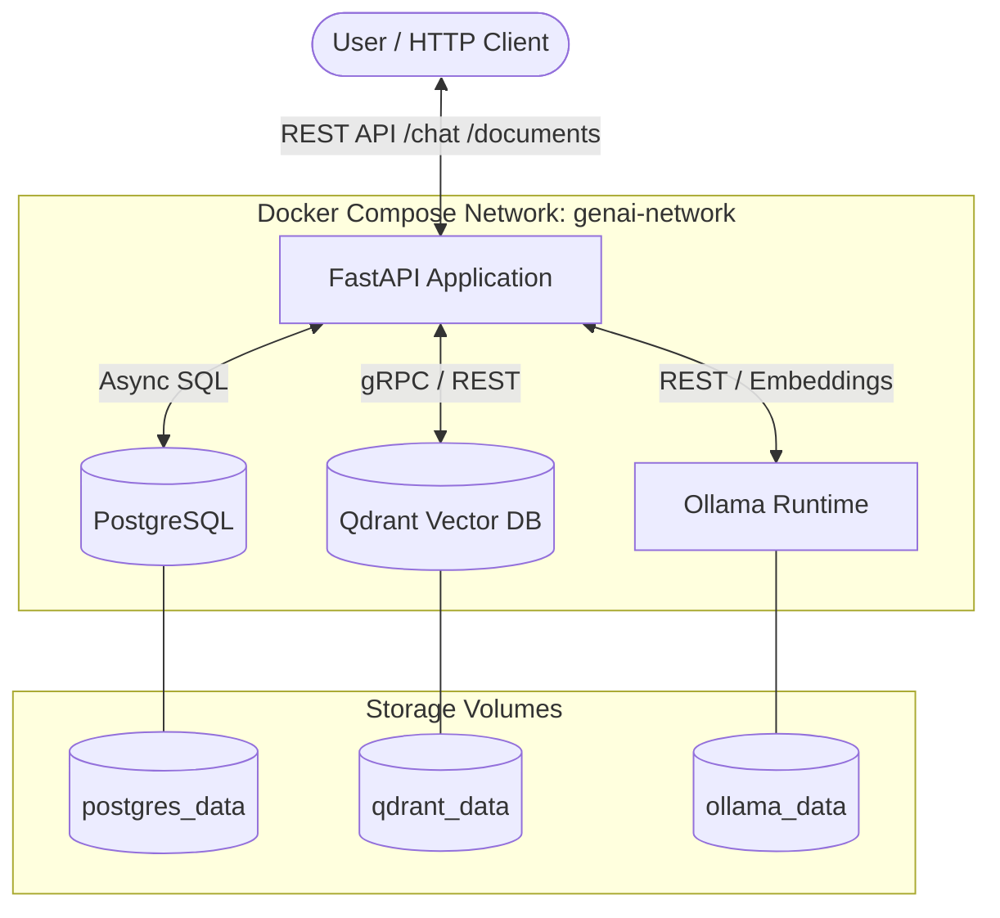
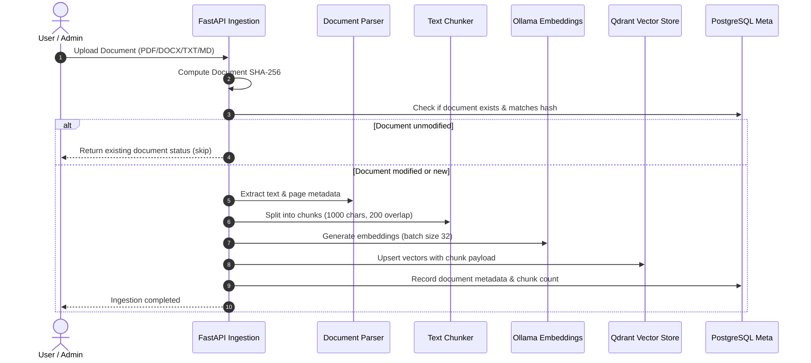
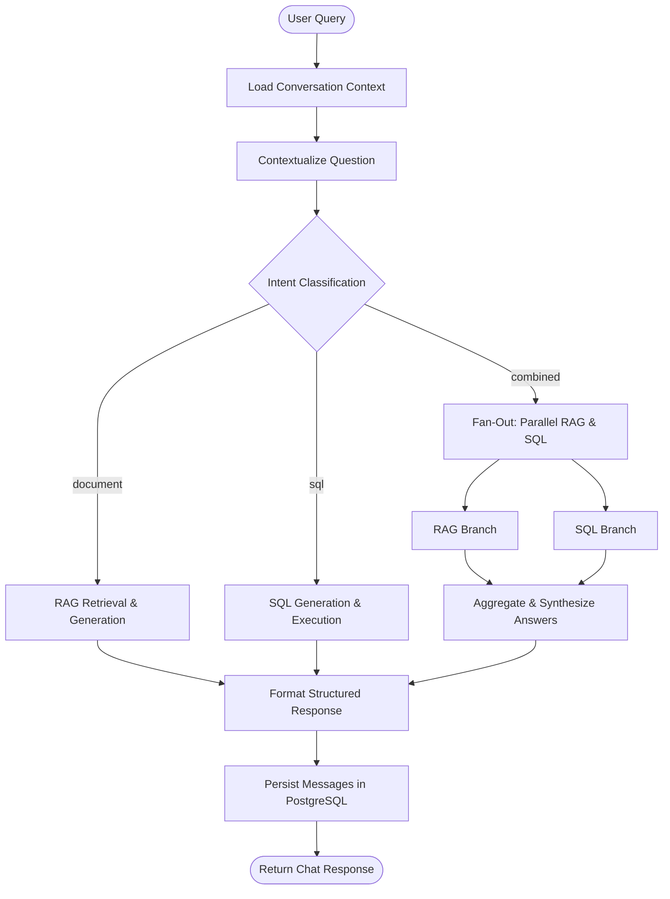

# Architecture Specification: Local GenAI Data Assistant

## 1. System Overview

The **Local GenAI Data Assistant** provides a unified natural-language interface across unstructured enterprise documents and structured relational data. It is deployed as a secure, local-only system composed of four containerized services:
1. **API**: FastAPI application orchestrating LangGraph workflows, RAG, and NL2SQL.
2. **PostgreSQL**: Stores business transactional data, conversation history, and query audit logs.
3. **Qdrant**: Stores document vector embeddings and chunk metadata.
4. **Ollama**: Serves local open-weights LLMs and embedding models.

---

## 2. Core Components and Responsibilities

### 2.1 API & Orchestration Layer (`app.api`, `app.modules.graph`)
- **FastAPI Router**: Exposes endpoints `/chat`, `/documents/ingest`, `/documents`, `/documents/{id}`, and `/health`.
- **LangGraph State Graph**:
  - Contextualizes conversational follow-ups using previous dialog.
  - Classifies user intent into `document`, `sql`, or `combined`.
  - Routes execution to RAG, SQL Agent, or concurrently to both.
  - Synthesizes multi-source answers with explicit citation.

### 2.2 Grounded RAG Engine (`app.modules.rag`, `app.modules.retrieval`, `app.modules.ingestion`)
- **Document Parsers**: Format-specific parsers for PDF (page-aware via PyMuPDF), DOCX (python-docx), Markdown, and Plaintext.
- **Chunker & Metadata**: Recursive character text splitter with configurable chunk size (1000) and overlap (200). Generates deterministic SHA-256 content hashes.
- **Qdrant Client**: Manages vectors, cosine distance search, payload filtering by `document_id`, and batch upsert.
- **Grounded Response Builder**: Context formatted with strict boundary markers; explicit instructions forbidding instruction following from retrieved docs (anti-prompt injection); confidence evaluation based on retrieval scores.

### 2.3 PostgreSQL SQL Agent (`app.modules.sql_agent`)
- **Schema Inspector**: Introspects tables, columns, foreign keys, and indexes dynamically from PostgreSQL.
- **SQL Generator**: Constructs targeted SQL queries conditioned on user questions and discovered schema.
- **SQLGlot AST Validator**: Validates the syntax and AST structure recursively:
  - Whitelists only `exp.Select` statements.
  - Blocks any statement with `INSERT`, `UPDATE`, `DELETE`, `DROP`, `ALTER`, `TRUNCATE`, `CREATE`, `GRANT`, `REVOKE`.
  - Forbids multi-statement execution and data-modifying CTEs.
  - Enforces a table whitelist (`customers`, `products`, `orders`, `order_items`, `refunds`).
  - Automatically appends/enforces a maximum `LIMIT` clause.
- **SQL Executor**: Connects via a restricted `readonly_user` role with SELECT privileges only and an aggressive statement timeout (5s).
- **Correction Loop**: Feeds validation or execution errors back to the model for up to 2 correction attempts.

---

## 3. End-to-End Data Flows

### 3.1 Document Ingestion Flow

### 3.2 LangGraph Orchestration Flow (Chat)

---

## 4. Security Architecture & Boundary Isolation

1. **SQL Security**:
   - Two distinct database connections: Application DB connection (read/write on app tables like conversations) and Business DB connection for SQL Agent (read-only restricted role `readonly_user`).
   - SQLGlot AST validation ensures no query containing DDL or DML reaches the database.
   - Database role permissions at PostgreSQL engine level prevent any writes even in the event of an AST bypass.
2. **Untrusted Document Boundaries**:
   - All text retrieved from documents is encapsulated in `<context>` XML blocks with explicit system prompt guards against prompt injection.
3. **No External Network Egress**:
   - All services reside in an isolated Docker network (`genai-network`).
   - No external API keys or cloud model calls.
